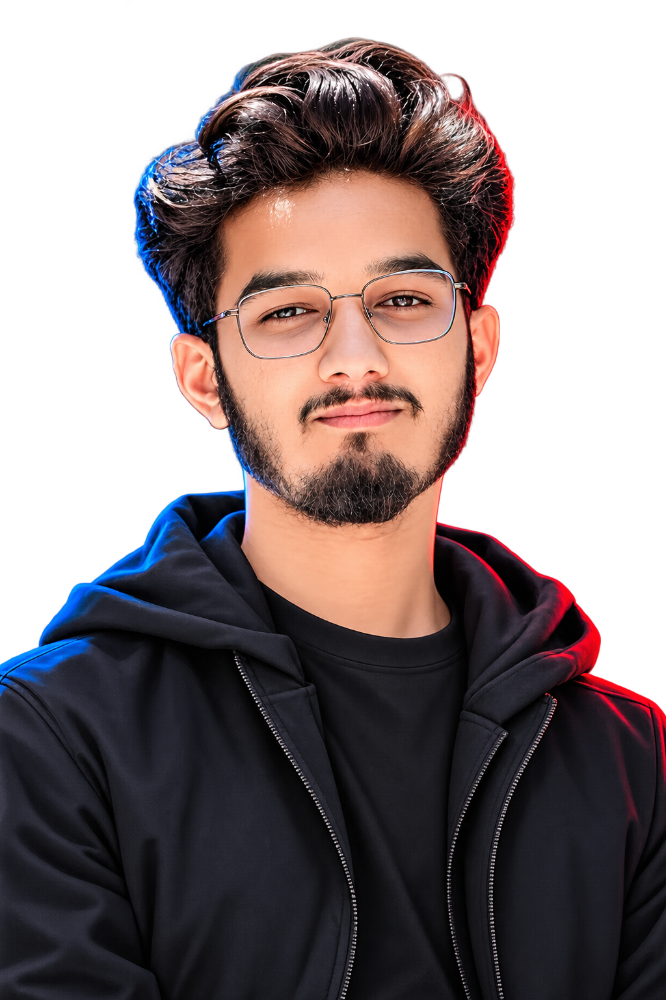

# Abuzar | AI & Machine Learning

---

- 🎓 BS Computer Science Graduate
- 🤖 AI & Machine Learning Enthusiast
- 📚 Learning AI at Corvit Muzaffarabad
- 📍 Muzaffarabad, Pakistan
- 🏏 Playing Cricket
- 🎮 Gaming
- 📖 Reading Books

 

---

| Project | Description |
|---|---|
| 🚗 Car Price Prediction | Machine Learning project |
| ♈ Zodiac Sign | Zodiac sign project |

---

---

---

### Thanks for visiting my profile! ❤️

*Learning • Building • Growing*

